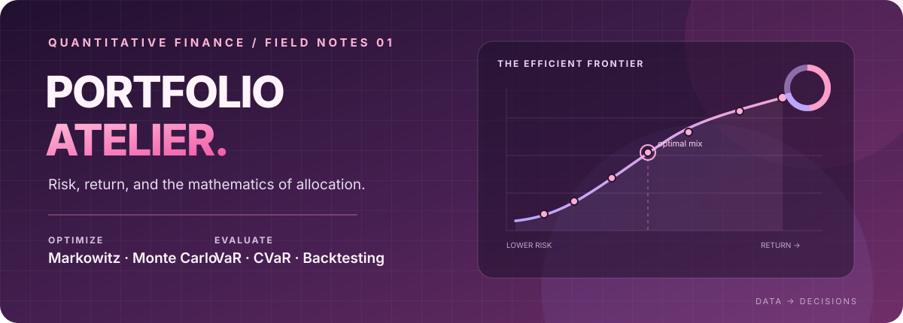
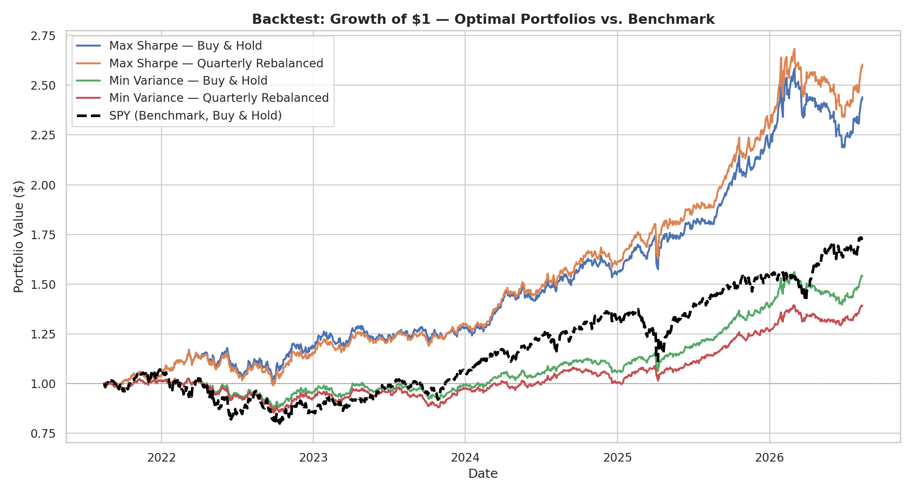
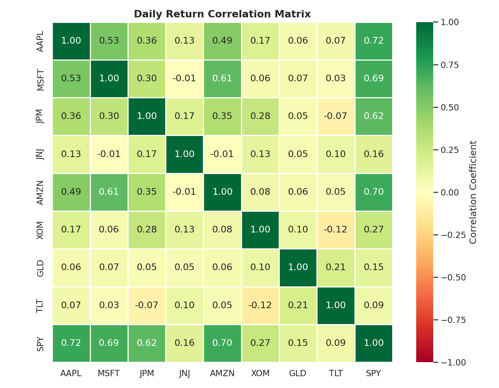
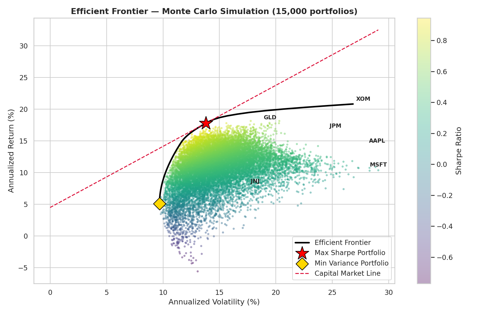

<div align="center">



<br>

[](https://www.python.org/)
[](#methodology)
[](#methodology)
[](#interactive-dashboard)
[](#limitations--future-work)

**An end-to-end quantitative investment project** — from daily market prices to portfolio optimization, risk measurement, backtesting, and an interactive dashboard.

</div>

---

## The question behind the numbers

Can a diversified portfolio selected through mathematical optimization outperform a passive benchmark **within a historical sample**—and what happens when we measure risk alongside return?

This Investment Management course project uses five years of daily market data to explore that question with **Modern Portfolio Theory**, constrained optimization, Monte Carlo simulation, and backtesting. The goal is not to promise future performance; it is to make the assumptions, trade-offs, and results inspectable.

## Performance snapshot

<table>
<tr>
<td width="25%" align="center">

### 21.3%

**Annualized return**

Max Sharpe · quarterly rebalanced

</td>
<td width="25%" align="center">

### 14.0%

**Annualized volatility**

Max Sharpe · quarterly rebalanced

</td>
<td width="25%" align="center">

### 1.14

**Sharpe ratio**

Max Sharpe · quarterly rebalanced

</td>
<td width="25%" align="center">

### −15.2%

**Maximum drawdown**

Max Sharpe · quarterly rebalanced

</td>
</tr>
</table>

### Strategy comparison

| Strategy | Annualized return | Annualized volatility | Sharpe ratio | Max drawdown |
|---|---:|---:|---:|---:|
| **Max Sharpe — Quarterly Rebalanced** | **21.3%** | **14.0%** | **1.14** | −15.2% |
| Max Sharpe — Buy & Hold | 19.7% | 14.7% | 1.00 | −15.4% |
| Min Variance — Buy & Hold | 9.1% | 10.4% | 0.46 | −15.4% |
| Min Variance — Quarterly Rebalanced | 6.8% | 9.7% | 0.28 | −16.7% |
| S&P 500 (SPY) — Benchmark | 11.6% | 17.3% | 0.47 | −25.4% |

<p align="center">
  
</p>

<sub>**These results are in-sample.** The portfolio weights are estimated on the same August 2021–August 2026 window that the backtest then evaluates, so they show how the strategies would have performed in hindsight—not how they would perform on unseen data. They are not a forecast or a guarantee, and the backtest does not include transaction costs or taxes.<br>Return is annualized as a compound rate (CAGR); Sharpe and Sortino use the annualized arithmetic mean of daily excess returns over a fixed 4.5% risk-free rate, so Sharpe cannot be recomputed exactly from the rounded return and volatility columns.</sub>

---

## From market data to a portfolio decision

<div align="center">

| 01 · PREPARE | 02 · MEASURE | 03 · OPTIMIZE | 04 · TEST |
|:---:|:---:|:---:|:---:|
| Clean and align daily prices | Quantify return and downside risk | Explore feasible risk-return mixes | Compare rebalancing strategies |
| `data_cleaning.py` | `risk_metrics.py` | `portfolio_optimization.py` | `backtesting.py` |

</div>

### 01 / Understand the market

Exploratory analysis covers normalized prices, cumulative returns, return distributions, rolling volatility, and cross-asset correlations. GLD and TLT showed relatively low correlation with the equity holdings in this sample (about −0.12 to 0.10 against the six stocks), making diversification worth investigating rather than assuming.

<p align="center">
  
</p>

### 02 / Put risk on the same page as return

The metric suite includes Sharpe, Sortino, Calmar, maximum drawdown, historical and parametric VaR, CVaR, Beta, and Jensen's Alpha. This helps distinguish ordinary volatility from downside exposure and benchmark-relative performance.

### 03 / Search the feasible portfolio space

The optimizer uses constrained quadratic optimization with SciPy's SLSQP to identify minimum-variance and maximum-Sharpe portfolios. A **15,000-portfolio Monte Carlo simulation** provides an additional visual check on the risk-return landscape.

<p align="center">
  
</p>

The Maximum Sharpe solution allocated approximately **50% to GLD, 23% to XOM, 17% to JPM, 7% to AAPL, and 3% to JNJ**. Those weights are the optimizer's result for the selected sample and assumptions—not a universal allocation recommendation. The solution is concentrated (half the portfolio in gold) because the long-only optimizer has no per-asset weight cap, and it is estimated on the full sample, so it is in-sample by construction. The optimizer works on log returns, while the backtest uses simple returns; this is why the optimizer's own Sharpe estimate (0.96) differs from the backtested 1.14.

### 04 / Test the strategy through time

The backtest compares buy-and-hold with quarterly rebalancing for both optimized portfolios, using SPY as the benchmark. Because the weights were fitted on the same window, this is an in-sample comparison. Quarterly rebalancing improved the Max Sharpe portfolio's historical risk-adjusted result in this sample, but reduced the Minimum Variance portfolio's result—a useful reminder that rebalancing effects depend on the portfolio and period.

---

## The investment universe

The project uses eight portfolio assets—six equities across five sectors, gold, and long-duration US Treasury bonds—with SPY as a ninth series used only as the benchmark.

| Ticker | Asset | Role |
|---|---|---|
| AAPL | Apple | Technology equity |
| MSFT | Microsoft | Technology equity |
| JPM | JPMorgan Chase | Financials equity |
| JNJ | Johnson & Johnson | Healthcare equity |
| AMZN | Amazon | Consumer discretionary equity |
| XOM | Exxon Mobil | Energy equity |
| GLD | SPDR Gold Shares | Gold exposure |
| TLT | iShares 20+ Year Treasury Bond ETF | Long-duration fixed income |
| SPY | SPDR S&P 500 ETF Trust | Benchmark |

Daily OHLCV data spans **August 2021 to August 2026**, sourced from WSJ Market Data. Returns are calculated as both simple and logarithmic returns; annualized metrics use 252 trading days per year.

---

## Interactive dashboard

The Streamlit app brings the analysis into one place:

| View | What you can explore |
|---|---|
| **Overview** | Asset universe, sample period, and headline metrics |
| **Price & Returns** | Normalized prices, cumulative returns, and return distributions |
| **Risk Analysis** | Risk metrics, correlation heatmap, and risk-return scatter |
| **Portfolio Optimization** | Optimal allocations and efficient frontier |
| **Backtest** | Strategy comparison and equity curves |

Launch it locally with:

```bash
streamlit run dashboard/app.py
```

## Repository map

```text
investment-portfolio-analysis/
├── data/
│   ├── raw/                      # Original market-data CSVs
│   └── processed/                # Cleaned and derived datasets
├── src/
│   ├── config.py                 # Paths, tickers, and assumptions
│   ├── data_cleaning.py          # Ingestion, validation, alignment
│   ├── eda.py                    # Exploratory analysis and charts
│   ├── risk_metrics.py           # Risk and return calculations
│   ├── portfolio_optimization.py # Markowitz + Monte Carlo
│   └── backtesting.py            # Strategy simulations
├── dashboard/
│   └── app.py                    # Interactive Streamlit dashboard
├── notebooks/
│   └── portfolio_analysis.ipynb  # Narrated walkthrough of the full analysis
├── figures/                      # Generated charts and hero artwork
├── requirements.txt
└── README.md
```

## Run the project

```bash
# 1. Clone the repository
git clone https://github.com/ParnazAli/investment-portfolio-analysis.git
cd investment-portfolio-analysis

# 2. Install dependencies
pip install -r requirements.txt

# 3. Run the analysis stages in sequence
python -m src.data_cleaning
python -m src.eda
python -m src.risk_metrics
python -m src.portfolio_optimization
python -m src.backtesting

# 4. Open the dashboard
streamlit run dashboard/app.py
```

Each stage reads the processed inputs generated by the previous stage. Start from the raw CSVs and run the pipeline in order for a reproducible workflow.

## Tools & methods

- **Data wrangling:** pandas, NumPy
- **Statistics and optimization:** SciPy, constrained SLSQP optimization
- **Risk analysis:** Sharpe, Sortino, Calmar, VaR, CVaR, Beta, Jensen's Alpha
- **Simulation:** 15,000-portfolio Monte Carlo experiment
- **Visualization:** Matplotlib, Seaborn, Plotly
- **Application:** Streamlit

## Limitations & next experiments

- **In-sample design:** weights are optimized and backtested on the same 2021–2026 window, so results are not out-of-sample evidence. Results also depend on the selected historical window and the assumptions used.
- The risk-free rate is fixed at 4.5% annualized rather than modeled as a time-varying series.
- Transaction costs and taxes are not included, which can materially affect rebalanced strategies.
- The investable universe is static; short selling, leverage, and changing constituents are outside the current model.
- The long-only optimizer has no weight cap, so the Max Sharpe portfolio is concentrated (about 50% in GLD).
- Returns and Sharpe use different conventions (CAGR versus arithmetic-mean excess return), and the optimizer uses log returns while the backtest uses simple returns.

**Next:** test rolling and expanding estimation windows to evaluate the strategies out-of-sample, add factor-based risk decomposition (such as Fama–French), and explore Black–Litterman optimization to combine market equilibrium with explicit views.

---

## About

**Parnaz Ali**  
Investment Management course project · Islamic Azad University, Science and Research Branch

[GitHub profile](https://github.com/ParnazAli) · [Email](mailto:parnazali1383@gmail.com)

<sub>For academic and educational purposes only. This repository is not investment advice.</sub>
